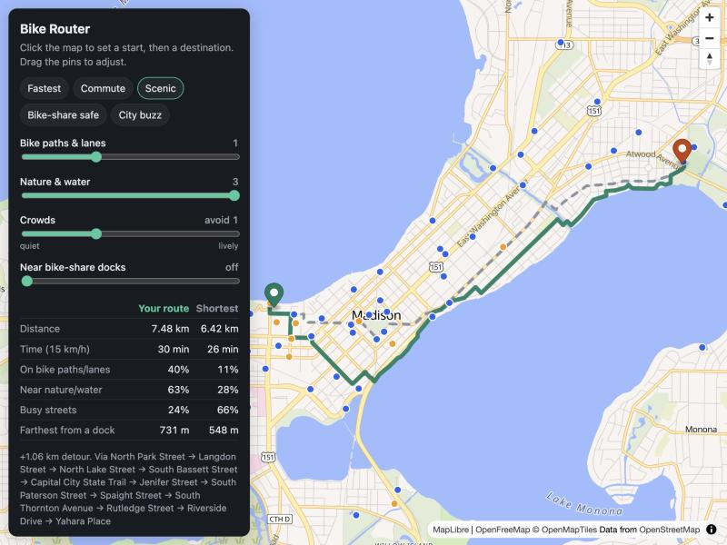

# Bike Router

Bike directions that follow **your** priorities, not just the shortest line.


Mapping apps give cyclists one or two route options. This one lets you say what you
care about and see what it costs you:

- **Bike paths & lanes** – stick to separated paths and painted lanes
- **Nature & water** – ride past parks, woods and lakeshore
- **Crowds** – seek busy, lively streets, or avoid them
- **Near bike-share docks** – stay close to stations that have bikes or open docks
  *right now*, so a dead e-bike battery or a mechanical problem is a short walk from a swap

It's built for Madison, WI with live [Madison BCycle](https://madison.bcycle.com) dock data,
but works for any city in OpenStreetMap and any bike-share system that publishes
[GBFS](https://gbfs.org) (Lyft's Citi Bike, Divvy, Bay Wheels and others included).

Each request returns your route next to the shortest one, so the trade-off is explicit:
"+0.6 km, but 85% on bike paths instead of 40%."

## How it works

```
OpenStreetMap ──► scripts/build_graph.py ──► data/graph.npz
                  score every segment:         (per-edge scores)
                  bike / green / lively               │
                                                      ▼
GBFS feed (live) ─────────────────────────► backend/app.py ──► frontend/
                  distance to nearest usable dock    weighted Dijkstra   MapLibre map
```

**Scoring (offline).** Each street segment gets three scores between 0 and 1:

| Score | Source | Rule |
|---|---|---|
| `bike` | OSM `highway`, `cycleway*`, `bicycle` tags | 1.0 dedicated cycleway → 0.6 painted lane → 0.35 quiet residential → 0 arterial |
| `green` | OSM parks, woods, wetlands, water, rivers | Distance from 3 points along the segment to the nearest green/water feature; 0 m = 1.0, 120 m+ = 0 |
| `lively` | OSM shops, cafes, restaurants, bars, libraries, tourism | Destinations within 120 m, log-scaled, 25+ = 1.0 |

**Routing (per request).** A segment's cost is its length, inflated by how badly it misses
each preference:

```
cost = length × (1 + w_bike·(1 − bike) + w_green·(1 − green) + |w_lively|·(1 − lively or lively) + w_dock·dock_penalty)
```

`dock_penalty` is the distance to the nearest station with a bike or an open dock, from the
live GBFS feed, capped at 800 m. Weights go from 0 (ignore) to 3 (a segment that fully misses
the preference counts as four times its length). The weighted graph is solved with SciPy's
Dijkstra, which takes well under a second for all of Madison.

## Run it locally

Requires Python 3.10+.

```bash
python -m venv .venv
source .venv/bin/activate
pip install -r requirements.txt

# Download and score Madison's network (a few minutes; cached after the first run)
python scripts/build_graph.py

# If the public Overpass server is busy, use a mirror:
# python scripts/build_graph.py --overpass-url https://overpass.private.coffee/api

uvicorn backend.app:app --reload
```

Open <http://localhost:8000>. Click to set a start and destination, then move the sliders.

### Another city

```bash
python scripts/build_graph.py --place "Chicago, Illinois, USA"
GBFS_URL=https://gbfs.lyft.com/gbfs/2.3/chi/gbfs.json uvicorn backend.app:app
```

Then change the map's starting center in `frontend/app.js`. Large cities take longer to
download and need more memory.

## API

`GET /api/route?from_lat=&from_lon=&to_lat=&to_lon=&bike=1.5&green=0&lively=0&dock=0`

Returns `preferred` and `shortest`, each with a GeoJSON `geometry`, `distance_m`,
`duration_min`, `bike_infra_pct`, `green_pct`, `lively_pct`, `max_dock_gap_m` and `streets`.

`GET /api/stations` returns live bike-share stations with bike, e-bike and dock counts.

## Ideas for later

- **Battery-aware e-bike mode:** given the remaining charge, guarantee a dock within reach at every point
- **Natural-language preferences:** "scenic, but I need to be there by 5" → weights
- **Hills:** add elevation so riders can avoid climbs
- **Safety:** crash data, speed limits and street lighting (weighted more after dark)
- **Several alternatives:** return a spread of routes along the time-vs-preference trade-off

## Data & licenses

- Map and street data © [OpenStreetMap contributors](https://www.openstreetmap.org/copyright), ODbL.
  Generated files in `data/` and `cache/` are not committed; rebuild them with the script.
- Base map tiles from [OpenFreeMap](https://openfreemap.org).
- Bike-share data from the Madison BCycle GBFS feed. Check your system's feed license before
  using it elsewhere.
- Code: MIT, see [LICENSE](LICENSE).
