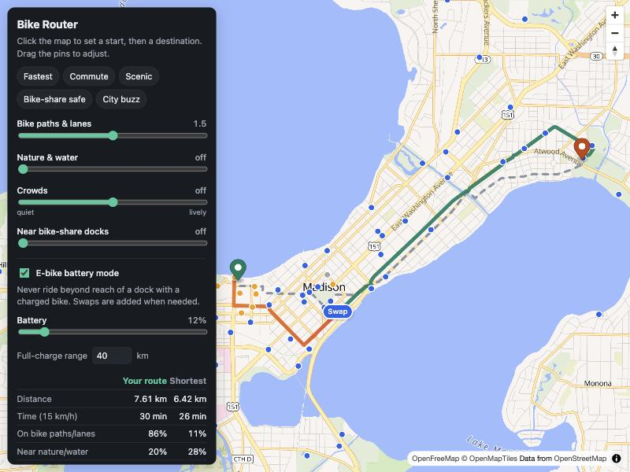

# Bike Router

Bike directions that follow **your** priorities, not just the shortest line.

**[Try the live demo →](https://zsif-bike-router.static.hf.space)** (Madison, WI; runs entirely in your browser)


Mapping apps give cyclists one or two route options. This one lets you say what you
care about and see what it costs you:

- **Bike paths & lanes** – stick to separated paths and painted lanes
- **Nature & water** – ride past parks, woods and lakeshore
- **Crowds** – seek busy, lively streets, or avoid them
- **Near bike-share docks** – stay close to stations that have bikes or open docks
  *right now*, so a dead e-bike battery or a mechanical problem is a short walk from a swap
- **E-bike battery mode** – a hard guarantee instead of a preference: enter your charge and the
  route never takes you beyond reach of a dock with a charged bike, adding swaps when needed

It's built for Madison, WI with live [Madison BCycle](https://madison.bcycle.com) dock data,
but works for any city in OpenStreetMap and any bike-share system that publishes
[GBFS](https://gbfs.org) (Lyft's Citi Bike, Divvy, Bay Wheels and others included).

Each request returns your route next to the shortest one, so the trade-off is explicit:
"+0.6 km, but 85% on bike paths instead of 40%."

## How it works

```
OpenStreetMap ──► scripts/build_graph.py ──► data/graph.npz
                  score every segment:         (per-edge scores)
                  bike / green / lively               │
                                                      ▼
GBFS feed (live) ─────────────────────────► backend/app.py ──► frontend/
                  distance to nearest usable dock    weighted Dijkstra   MapLibre map
                                                     + battery.py (A* over docks)
```

The Python backend is the reference implementation, with the tests and an HTTP API. For the
demo, [`frontend/router.js`](frontend/router.js) ports the same routing and battery planner to
JavaScript and runs it in a Web Worker, so the site is just static files: the graph ships as an
8.7 MB binary (3.2 MB gzipped) and dock data comes straight from the GBFS feed. Across 90 random
trips the two versions pick the same routes and swaps, with distances within 2 m (the browser
stores coordinates as 32-bit floats).

**Scoring (offline).** Each street segment gets three scores between 0 and 1:

| Score | Source | Rule |
|---|---|---|
| `bike` | OSM `highway`, `cycleway*`, `bicycle` tags | 1.0 dedicated cycleway → 0.6 painted lane → 0.35 quiet residential → 0 arterial |
| `green` | OSM parks, woods, wetlands, water, rivers | Distance from 3 points along the segment to the nearest green/water feature; 0 m = 1.0, 120 m+ = 0 |
| `lively` | OSM shops, cafes, restaurants, bars, libraries, tourism | Destinations within 120 m, log-scaled, 25+ = 1.0 |

**Routing (per request).** A segment's cost is its length, inflated by how badly it misses
each preference:

```
cost = length × (1 + w_bike·(1 − bike) + w_green·(1 − green) + |w_lively|·(1 − lively or lively) + w_dock·dock_penalty)
```

`dock_penalty` is the distance to the nearest station with a bike or an open dock, from the
live GBFS feed, capped at 800 m. Weights go from 0 (ignore) to 3 (a segment that fully misses
the preference counts as four times its length). A route across Madison takes about 50 ms in
the browser.

## E-bike battery mode



Shared e-bikes die mid-ride. Turn on battery mode, set your charge, and the router guarantees:

> At every point of the ride, the charge left is enough to reach a dock where you can swap
> for a charged bike.

If the destination is out of range, the route goes through a dock on the way and tells you
where to swap. The line is coloured by charge left, and the app shows how close the ride
cuts it and where your normal route would have stranded you ("out of reach of any dock after
4.57 km, flat at 4.80 km").

This is the electric-car charging-stop problem at bike scale. [`backend/battery.py`](backend/battery.py)
solves it in two levels:

1. **Leg search.** From a stop with range *r*, Dijkstra that never enters a node *v* where
   `distance ridden to v + distance from v to the nearest dock > r`. Offending nodes are pruned
   and the search re-run until the tree is clean (the browser version prunes during a single
   pass, which gives the same result on distance). On plain distance this is **exact**: it reaches
   a node if and only if some safe path exists. A preference-weighted version gives nicer legs and
   falls back to the exact one when it misses.
2. **Stop search.** A\* over {start, docks with a charged bike and an open slot, destination}, where
   each edge is a safe leg. Legs cost their preference-weighted length, swaps add a fixed
   penalty, and the heuristic is the unconstrained cost-to-go (a lower bound, so A\* stays optimal
   over these legs).

Distance to the nearest dock is a multi-source Dijkstra on the reversed graph, recomputed from
the live feed on every request. Battery trips across Madison plan in well under a second.

Assumptions: energy use is proportional to distance (Madison is fairly flat), the full-charge
range is yours to set (default 40 km), and a swapped bike is at 90%, because GBFS doesn't
report each docked bike's charge.

<br clear="right">

## Run it locally

Requires Python 3.10+.

```bash
python -m venv .venv
source .venv/bin/activate
pip install -r requirements.txt

# Download and score Madison's network (a few minutes; cached after the first run)
python scripts/build_graph.py

# If the public Overpass server is busy, use a mirror:
# python scripts/build_graph.py --overpass-url https://overpass.private.coffee/api

# Pack the graph for the browser router
python scripts/export_static.py

uvicorn backend.app:app --reload
```

Open <http://localhost:8000>. Click to set a start and destination, then move the sliders.
The page only needs static files, so `python -m http.server -d frontend` works too; uvicorn
also serves the API below.

### Deploy

```bash
huggingface-cli login            # once, with a write token
python scripts/deploy_space.py
```

This publishes `frontend/` as a free static [Hugging Face Space](https://huggingface.co/docs/hub/spaces-sdks-static).
Any static host (GitHub Pages, Netlify) works the same way.

### Tests

```bash
python -m pytest
```

The battery tests run on small hand-built graphs, including a brute-force check against every
simple path in 25 random graphs that the leg search finds exactly the safe shortest distances.

### Another city

```bash
python scripts/build_graph.py --place "Chicago, Illinois, USA"
python scripts/export_static.py
```

Then set `GBFS_URL` (for example `https://gbfs.lyft.com/gbfs/2.3/chi/gbfs.json`) and the
starting center in `frontend/app.js`; for the API, set the `GBFS_URL` environment variable. Large cities take longer to
download and need more memory.

## API

`GET /api/route?from_lat=&from_lon=&to_lat=&to_lon=&bike=1.5&green=0&lively=0&dock=0`

Returns `preferred` and `shortest`, each with a GeoJSON `geometry`, `distance_m`,
`duration_min`, `bike_infra_pct`, `green_pct`, `lively_pct`, `max_dock_gap_m` and `streets`.

Add `&battery=12&range_km=40` for battery mode. `preferred` then also has a `battery` object:
`swaps` (where and after how far), `arrive_pct`, `min_margin_m`, a charge `profile` along the
route, and `without`: where the ordinary route would leave you out of reach of a dock and empty.
Returns 422 with an explanation when no safe route exists.

`GET /api/stations` returns live bike-share stations with bike, e-bike and dock counts.

## Ideas for later

- **Hills in battery mode:** charge used climbing, not just distance
- **Natural-language preferences:** "scenic, but I need to be there by 5" → weights
- **Hills:** add elevation so riders can avoid climbs
- **Safety:** crash data, speed limits and street lighting (weighted more after dark)
- **Several alternatives:** return a spread of routes along the time-vs-preference trade-off

## Data & licenses

- Map and street data © [OpenStreetMap contributors](https://www.openstreetmap.org/copyright), ODbL.
  Generated files in `data/`, `frontend/data/` and `cache/` are not committed; rebuild them
  with the scripts.
- Base map tiles from [OpenFreeMap](https://openfreemap.org).
- Bike-share data from the Madison BCycle GBFS feed. Check your system's feed license before
  using it elsewhere.
- Code: MIT, see [LICENSE](LICENSE).
